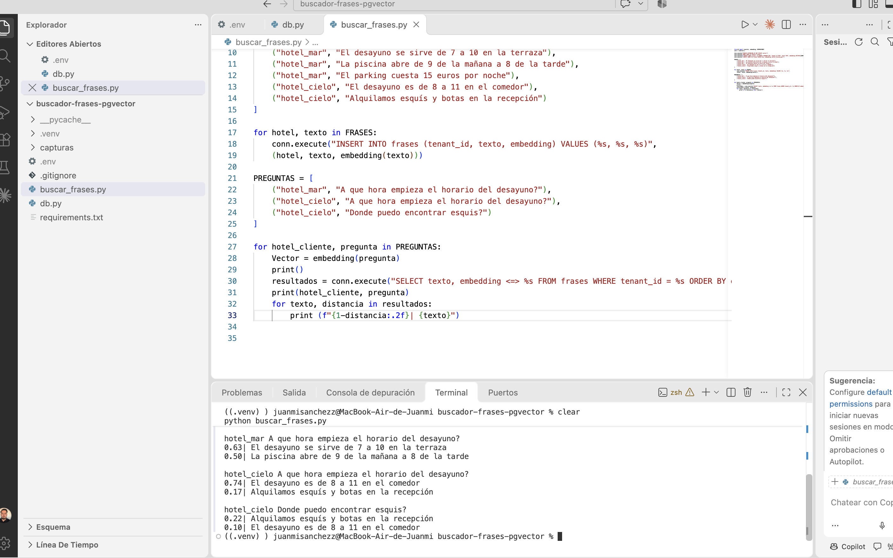

# Buscador de frases con pgvector y tenants

Proyecto 9 del máster de AI Engineering de thePower.

Guardo 5 frases cortas de dos hoteles en PostgreSQL con pgvector y recibiendo una pregunta, devuelvo las 2 frases más parecidas por significado. Cada hotel es un cliente distinto de la plataforma (un tenant), así que todas las búsquedas van filtradas por hotel: un hotel nunca ve las frases del otro.

## Cómo funciona

- Los embeddings los saco en local con sentence-transformers (`paraphrase-multilingual-MiniLM-L12-v2`, 384 dimensiones, gratis y entiende español).
- La base de datos está en Neon, que es PostgreSQL con pgvector. Con Docker sería el mismo código; solo cambia la cadena de conexión.
- La tabla `frases` tiene una columna `tenant_id` con el hotel de cada frase.
- Para buscar, convierto la pregunta en embedding con el mismo modelo y pido a Postgres las 2 frases de ese hotel con menos distancia coseno (`<=>`), con `WHERE tenant_id = %s` y `LIMIT 2`.
- Un índice HNSW sobre la columna del embedding hace que la búsqueda siga siendo rápida aunque crezca la tabla.

En la salida enseño la similitud (1 menos la distancia), así que más alto es más parecido.

## Archivos

- `db.py`: conexión a la base de datos y función que convierte texto en embedding.
- `buscar_frases.py`: crea la tabla, guarda las 5 frases y hace las 3 preguntas de prueba.

## Ejecutarlo

```
python3.12 -m venv .venv
source .venv/bin/activate
pip install -r requirements.txt
```

Crea un archivo `.env` con la cadena de conexión de tu base de datos de Neon (o de tu Postgres en Docker), con el nombre de variable que lee `db.py`. Y ejecuta:

```
python buscar_frases.py
```

La primera vez descarga el modelo (unos 470 MB).

## Resultado

```
hotel_mar A que hora empieza el horario del desayuno?
0.63| El desayuno se sirve de 7 a 10 en la terraza
0.50| La piscina abre de 9 de la mañana a 8 de la tarde

hotel_cielo A que hora empieza el horario del desayuno?
0.74| El desayuno es de 8 a 11 en el comedor
0.17| Alquilamos esquís y botas en la recepción

hotel_cielo Donde puedo encontrar esquis?
0.22| Alquilamos esquís y botas en la recepción
0.10| El desayuno es de 8 a 11 en el comedor
```

En las tres preguntas la frase correcta sale la primera. La pregunta del desayuno es la misma para los dos hoteles y cada uno recibe su propio horario (de 7 a 10 en uno y de 8 a 11 en el otro), así que el aislamiento entre tenants funciona.


